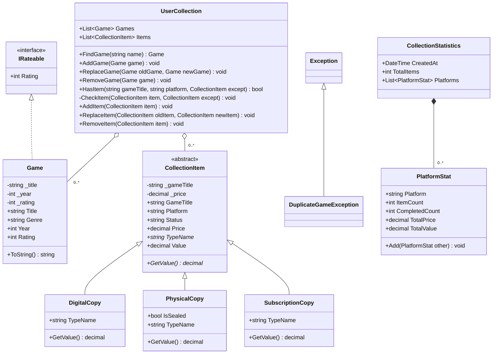

# DESIGN.md – Каталог відеоігор з колекцією користувача

Курсова робота з дисципліни «Об’єктно-орієнтоване програмування», група 3РП-11.
Стек: C# (.NET 10), Avalonia UI 12, CommunityToolkit.Mvvm, архітектура MVVM. Середовище: JetBrains Rider.

> Розділ 1 – чернетка ШІ (Claude Opus 5.5) з відповідей студентки; для записки переписати своїми словами.
> Розділ 2.1 – обґрунтування студентки. Розділи 2.2–5 – опис, складений ШІ за готовим кодом.

## 1. Опис предметної області

Програму використовують геймери, які хочуть вести облік своїх відеоігор: тих, які хочуть пройти, проходять зараз або вже завершили. Вона підійде і звичайним гравцям, які хочуть зібрати свою бібліотеку ігор в одному місці.

Про кожну гру програма зберігає назву, жанр, рік виходу і рейтинг від 1 до 10.

Про копію гри в колекції користувача програма зберігає, на якій платформі вона є, тип копії, ціну і статус проходження (не почато, граю, пройдено, закинуто). Одна гра може мати кілька копій на різних платформах.

Копія гри буває трьох типів:
- цифрова – ліцензія, куплена в цифровому магазині (Steam, PlayStation Store, Microsoft Store);
- фізична – диск або картридж; запакована фізична копія цінується дорожче;
- підписка – гра доступна, поки користувач платить щомісяця (Xbox Game Pass, PS Plus), але не належить йому.

Користувач може додавати, змінювати й видаляти ігри та копії, шукати гру за назвою, фільтрувати колекцію за платформою, жанром і статусом, сортувати ігри за рейтингом, завантажувати і зберігати каталог у файл JSON, а також переглядати статистику колекції за платформами і зберігати її у файл XML.

## 2. Сутності та ієрархія класів

### 2.1 Обраний варіант і обґрунтування

Розглядались два варіанти: (А) абстрактний клас `CollectionItem` і три похідні класи; (Б) один клас `CollectionItem` з полем «тип копії» і перевірками `if` у розрахунку вартості.

Обрано варіант А. Обґрунтування (студентка):

> Тому що у них відрізняється вартість, і щоб програма правильно розраховувала ціну кожного виду копії, краще зробити це абстрактним класом з трьома нащадками.

### 2.2 Класи предметної області (Models)

| Клас | Призначення | Принцип ООП |
|---|---|---|
| `IRateable` | інтерфейс: об’єкт має рейтинг `Rating` | абстракція |
| `Game : IRateable` | гра: назва, жанр, рік, рейтинг; перевірки в властивостях (назва обов’язкова, рік ≥ 1970, рейтинг 1–10) | інкапсуляція |
| `CollectionItem` (abstract) | копія гри: `GameTitle`, `Platform`, `Status`, `Price` (≥ 0); абстрактні `GetValue()` і `TypeName` | абстракція, наслідування |
| `DigitalCopy` | вартість = ціна | поліморфізм |
| `PhysicalCopy` | `IsSealed`; запакована – ціна × 1,5, інакше ціна | поліморфізм |
| `SubscriptionCopy` | вартість 0 (гра не належить користувачу) | поліморфізм |
| `UserCollection` | списки `Games` і `Items`; додавання, заміна, видалення з перевіркою дублікатів | інкапсуляція логіки |
| `DuplicateGameException : Exception` | власний виняток: гра вже є в каталозі або на платформі | наслідування |
| `PlatformStat`, `CollectionStatistics` | статистика за платформами (для таблиці і XML) | – |

Поліморфізм під час виконання: `StatisticsService` перебирає `List<CollectionItem>` і для кожної копії викликає `item.GetValue()` – спрацьовує версія того класу, яким є копія.

### 2.3 Діаграма класів (Mermaid, чернетка; фінальна – у draw.io)



### 2.4 Шари MVVM

- **Model** – `Models/`: класи предметної області (вище).
- **Сервіси** – `Services/`: `JsonStorage` (JSON), `XmlExporter` (XML), `CatalogFilter` (пошук, фільтри, сортування), `StatisticsService` (статистика, одно- і багатопотоково), `ImportService` (фоновий імпорт), `CatalogGenerator` (тестові дані).
- **ViewModel** – `ViewModels/MainViewModel`: дані для таблиць і форм, команди кнопок (`[RelayCommand]`), виклики сервісів.
- **View** – `Views/MainWindow.axaml`: розмітка вікна, прив’язки `{Binding}`.

## 3. Структура JSON і XML

`games.json` (System.Text.Json; поле `copyType` визначає клас-нащадок копії):

```json
{
  "games": [
    { "title": "The Witcher 3: Wild Hunt", "genre": "RPG", "year": 2015, "rating": 10 },
    { "title": "Hollow Knight", "genre": "Платформер", "year": 2017, "rating": 9 }
  ],
  "items": [
    { "copyType": "digital", "gameTitle": "Hollow Knight", "platform": "PC", "price": 499.0, "status": "Пройдено" },
    { "copyType": "physical", "gameTitle": "The Witcher 3: Wild Hunt", "platform": "Nintendo Switch", "price": 1299.0, "status": "Граю", "isSealed": true },
    { "copyType": "subscription", "gameTitle": "Hollow Knight", "platform": "Xbox Series X|S", "price": 449.0, "status": "Не почато" }
  ]
}
```

`statistics.xml` (XmlSerializer):

```xml
<CollectionStatistics>
  <CreatedAt>2026-11-20T18:28:31</CreatedAt>
  <TotalItems>56</TotalItems>
  <Platforms>
    <PlatformStat name="PC">
      <ItemCount>26</ItemCount>
      <CompletedCount>7</CompletedCount>
      <TotalPrice>20424.0</TotalPrice>
      <TotalValue>18778.5</TotalValue>
    </PlatformStat>
  </Platforms>
</CollectionStatistics>
```

Пошкоджений або некоректний файл: `JsonStorage.Load` перехоплює `JsonException`, `NotSupportedException`, `ArgumentException`, пише `Log.Error` і кидає `InvalidDataException` з повідомленням для користувача.

## 4. Фонова обробка

| Що | Де | Як |
|---|---|---|
| Генерація 10 000 записів | `MainViewModel.GenerateCatalogAsync` | `Task.Run` |
| Імпорт з перевіркою дублікатів | `ImportService.ImportAsync` | `Task.Run`; працює з копіями множин назв (`HashSet`), каталог змінюється лише в потоці інтерфейсу після `await` |
| Паралельна статистика | `StatisticsService.CalculateParallelAsync` | список ділиться на частини, кожна – окремий `Task.Run` з власним словником; об’єднання у спільний словник під `lock (locker)` через `PlatformStat.Add`; `Task.WhenAll` |
| Прогрес | `IProgress<int>` (`Progress<int>`) | ProgressBar і відсоток |
| Повідомлення з фону | `Dispatcher.UIThread.Post` | журнал фонових операцій |
| Скасування | `CancellationTokenSource` / `CancellationToken` | кнопка «Скасувати», `ThrowIfCancellationRequested` у циклах |
| Порівняння режимів | `MainViewModel.CompareAsync` | `Stopwatch`, 20 повторів, S = T1 / Tn |

Спільні дані: словник `total` у `CalculateParallelAsync` – захищений `lock`. Множини `knownTitles` / `knownItemKeys` під час імпорту – копії, з якими працює лише один фоновий потік.

## 5. Вікна і сторінки

Одне головне вікно з боковим меню:
- **Огляд** – картки (ігор, копій, пройдено, вартість), діаграма копій за платформами, кільце прогресу, статуси, топ жанрів;
- **Каталог ігор** – таблиця ігор, пошук, фільтр за жанром, сортування за рейтингом, форма «Гра» (Нова / Додати / Зберегти зміни / Видалити);
- **Моя колекція** – таблиця копій, пошук, фільтри за платформою і статусом, форма «Копія гри»;
- **Імпорт і статистика** – генератор 10 000, фоновий імпорт з ProgressBar і скасуванням, паралельна статистика, порівняння T1/Tn, експорт XML, журнал фонових операцій.

Унизу – рядок повідомлень (помилки червоним). Бокове меню – файл JSON, «Завантажити» / «Зберегти».
